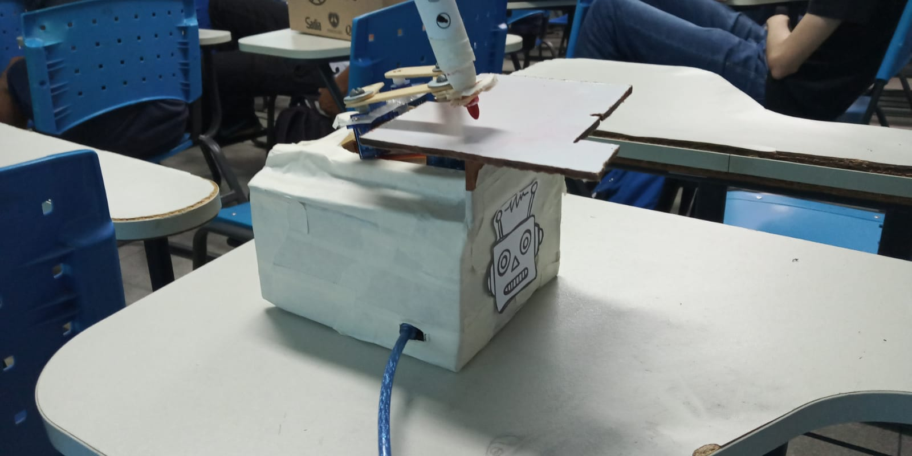
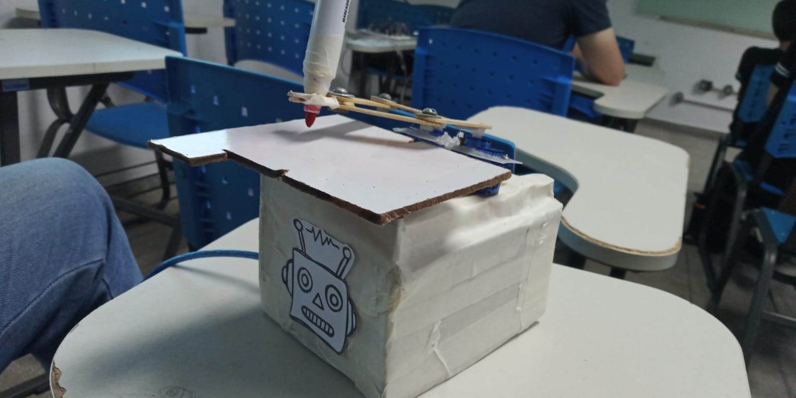
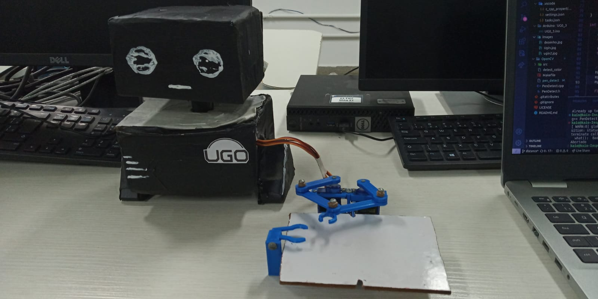

# UG0 & UGO 2.0 – Educational Robotics with Arduino and Computer Vision

Open-source project focused on **educational robotics**, integrating concepts from **mathematics**, **engineering**, **geometric planning**, and **programming**.  
This repository presents two versions of the robot: the initial **UG0** model and the enhanced **UGO 2.0**, which incorporates computer vision.

---

## 🚀 UG0 — First Version

A robot built using **Arduino** and servo motors, designed for educational purposes with movement logic based entirely on **angles** and the **Cartesian plane**.  
This version aims to teach mathematical reasoning through physical interaction and robot motion.

### **Materials Used**
- 3 Servos  
- 1 Protoboard  
- 1 Arduino Uno  

### 📸 Images

### 📹 Demonstration
[Watch the video](https://www.youtube.com/shorts/5RN0mQ5cIJ4)

### 👥 Contributors
- [Frankley Kaiky](https://github.com/Franky03)  
- [Matheus Felipe](https://github.com/MatheusFelipeLS)  
- [Kaio César](https://github.com/kaiocesarb15)  
- [Thaís Gabrielly](https://github.com/GabriellyMarques02)  
- [Camilly Queziz](https://github.com/CamillyQueziz)

---

## 🤖 UGO 2.0 — Enhanced Version with Computer Vision

The second iteration of the project integrates **OpenCV in C++** to track a pencil captured by a camera and reproduce its motion by drawing.  
In this version, the drawing arm was redesigned using **3D-printed components**, and the robot received a new illustrative body.

### 📸 Image

### 👥 Contributors
- [Frankley Kaiky](https://github.com/Franky03)  
- [Matheus Felipe](https://github.com/MatheusFelipeLS)  
- [Kaio César](https://github.com/kaiocesarb15)

---

## 📄 License
This project is open-source. Feel free to use, modify, and distribute according to the chosen license (add your license here).

## ⭐ Contributions
Contributions, issues, and feature requests are welcome!  
Feel free to open a pull request or start a discussion.

---
